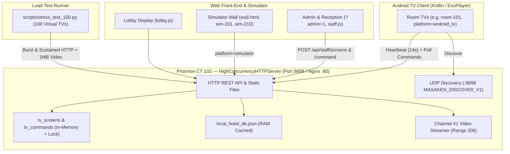

# TVIP Application Documentation (مساكن النزهة — نظام الترحيب والقنوات الفندقي)

## 1. نظرة عامة على المشروع (Overview)
نظام **TVIP (Masaken Hotel TV & IPTV)** هو منصة متكاملة لشاشات التلفاز الفندقية وإدارة النزلاء تعمل محلياً بالكامل داخل شبكة الفندق (Proxmox CT 102 على `http://192.168.1.50`) دون الحاجة للاتصال بالإنترنت أثناء التشغيل:
- **خادم محلي عالي التزامن (`scripts/local_hotel_server.py`)**: خادم Python يعمل عبر `HighConcurrencyHTTPServer` (`ThreadingHTTPServer` مع `request_queue_size = 512` و`daemon_threads = True`) وذاكرة تخزين مؤقتة في RAM، يخدم البوابة والـ API وبث فيديو القناة الترحيبية #1 والملفات الثابتة، إلى جانب اكتشاف تلقائي عبر UDP Broadcast (`MASAKEN_DISCOVER_V1` على المنفذ `8898`).
- **تطبيق Android TV (`android/`)**: تطبيق Kotlin أصلي (v3.4+) مخصص لأجهزة التلفاز الفندقية (مثل Xiaomi TV Stick)، يدعم الاكتشاف التلقائي للخادم، واجهة الترحيب، مشغل القنوات (ExoPlayer / QuickPlay)، الإشعارات، بث الوسائط من جوال النزيل، ومراقبة الشاشة والتحكم عن بُعد (`TvMonitor.kt`).
- **بوابة الويب ولوحة الإدارة (`index.html`, `js/`, `css/`)**: واجهة الترحيب للنزيل، بوابة اللوبي (`js/lobby.js`)، بوابة الجوال (`js/mobile-portal.js`)، ولوحة الاستقبال وإدارة الفندق (`js/staff.js` عبر `?admin=1`).
- **جدار المحاكاة (`wall.html`)**: محاكي تفاعلي يعرض 10 شاشات فندقية افتراضية (`sim-201`..`sim-210`) معزولة تماماً عن حالة الشاشات الحقيقية (`room-101` وغيرها).

---

## 2. المعمارية وتدفق البيانات (Architecture)



---

## 3. الملفات والمكونات الأساسية (Key Files)
- **الخادم والاختبار:**
  - `scripts/local_hotel_server.py` — الخادم المحلي، إدارة قاعدة البيانات، بث الفيديو، ومراقبة الشاشات.
  - `scripts/stress_test_100.py` — أداة اختبار الضغط لـ 100 شاشة (Burst + Sustained + Remote Command Delivery).
  - `scripts/local_hotel_db.json` — تخزين الغرف والنزلاء والإعدادات وسجل الشاشات.
- **الواجهة الأمامية (Web):**
  - `index.html` — الصفحة الرئيسية للنزيل، الجوال، ولوحة الموظفين (`?admin=1`).
  - `wall.html` — جدار المحاكاة التفاعلي (10 شاشات افتراضية).
  - `js/config.js` — قراءة معاملات الرابط (`room`, `pin`, `admin`, `sim`, `tv`).
  - `js/portal.js` — دورة حياة شاشة النزيل (جلب النزيل كل 10 ثوانٍ، نبضة الشاشة كل 14 ثانية، الإشعارات كل 20 ثانية).
  - `js/lobby.js` — منطق شاشة الاستقبال/اللوبي.
  - `js/staff.js` — لوحة التحكم ومراقبة الشاشات عن بُعد.
  - `js/supabase-client.js` — طبقة الاتصال بالخادم المحلي أو Supabase.
  - `css/app.css` — تنسيقات الواجهة.
- **تطبيق Android TV (Kotlin):**
  - `android/app/src/main/kotlin/com/example/tv_guest_welcome/` — يشمل `MainActivity.kt`, `SetupActivity.kt`, `ChannelsActivity.kt`, `QuickPlayActivity.kt`, `PlayerActivity.kt`, `TvMonitor.kt`, `ServerDiscovery.kt`, ومجلد `iptv/` (`IptvRepository.kt`, `IptvDefaults.kt`, `M3uParser.kt`).

---

## 4. واجهة برمجة التطبيقات (API Reference)
| Method | Endpoint | الوصف |
|--------|----------|-------|
| `POST` | `/api/tv/heartbeat` | تسجيل/تحديث حالة الشاشة (`room`, `mode`, `screen_state`, `app_version`, `platform`, `device_id`) واستلام الأوامر المعلقة (`commands`) |
| `POST` | `/api/staff/screens` | جلب حالة جميع الشاشات المسجلة والمتصلة (`ONLINE_TTL_SEC = 45`) — يتطلب `pin` |
| `POST` | `/api/staff/screens/command` | إرسال أمر عن بُعد (`reload`, `open_tv`, `open_portal`, `stop_cast`, `update_apk`) لشاشة محددة أو `all` |
| `POST` | `/api/staff/screens/remove` | حذف شاشة من السجل |
| `POST` | `/api/staff/screens/clear-sim` | مسح جميع شاشات المحاكاة (`sim-*` / `platform=simulator`) دون المساس بالشاشات الحقيقية |
| `GET` | `/api/guest?room=...` | جلب بيانات النزيل للغرفة |
| `GET` | `/api/settings` | إعدادات الفندق (Wi-Fi، الإفطار، المغادرة، التحويلة) |
| `GET` | `/api/widgets` | مواقيت الصلاة والطقس |
| `GET` | `/api/notifications?room=...&latest=1` | جلب إشعارات الغرفة |
| `GET` | `/api/channels.m3u` | قائمة القنوات المنسقة |
| `GET` | `/api/channel1/video` | بث فيديو القناة #1 مع دعم `Range` (HTTP 206) |

---

## 5. نتائج اختبارات الأداء والضغط (100-TV Stress Test Results)

تم تنفيذ اختبار الضغط الكامل عبر `scripts/stress_test_100.py` على الخادم الفعلي في Proxmox CT 102 (`http://192.168.1.50`) لمحاكاة **100 شاشة تلفاز متزامنة** باستخدام نمط الطلبات الحقيقي للتطبيق.

### المرحلة الأولى: الإقلاع المتزامن (Phase 1 — Burst Cold-Start: 100 TVs)
إقلاع 100 شاشة في نفس اللحظة (8 طلبات لكل شاشة: `index.html`, `widgets`, `guest`, `settings`, `notifications`, `channels.m3u`, `heartbeat`, ومقطع فيديو `1 MB` من القناة #1):

| المؤشر | القيمة |
|--------|--------|
| الزمن الكلي (Wall Time) | **3.33 ثانية** |
| الطلبات الناجحة | **800 / 800 (100% — 0 أخطاء)** |
| زمن استجابة API (الوسيط / P95 / الأقصى) | **72.4 ms** / **319.4 ms** / **1054 ms** |
| زمن تسليم 1 MB فيديو × 100 متزامن (الوسيط / P95 / الأقصى) | **1807.4 ms** / **2526.1 ms** / **2721 ms** |
| إجمالي الفيديو المنقول وسرعة الضخ | **100.0 MB** بمعدل **252.3 Mbps** |

### المرحلة الثانية: التشغيل المستمر (Phase 2 — Sustained Load: 100 TVs لمدة 240 ثانية)
تشغيل 100 شاشة متواصل لمدة 4 دقائق بالوتيرة الحقيقية (`guest` كل 10 ثوانٍ، `heartbeat` كل 14 ثانية، `notifications` كل 20 ثانية، ومقطع فيديو `1 MB` كل 10 ثوانٍ)، مع استعلام لوحة المراقبة `/api/staff/screens` كل 5 ثوانٍ وإرسال أمر تحكم عن بُعد (`open_portal`) لجميع الـ 100 شاشة:

| المؤشر | القيمة |
|--------|--------|
| المدة الزمنية | **240.0 ثانية** |
| إجمالي الطلبات الناجحة | **7,662 / 7,662 (100.00% — 0 أخطاء)** |
| معدل الطلبات | **31.9 req/s** |
| نبضة الشاشة (`heartbeat`, n=1700) | الوسيط **12.7 ms** • P95 **90.5 ms** • الأقصى **1020.8 ms** |
| بيانات النزيل (`guest`, n=2357) | الوسيط **13.9 ms** • P95 **81.6 ms** • الأقصى **1018.4 ms** |
| الإشعارات (`notif`, n=1200) | الوسيط **13.8 ms** • P95 **96.7 ms** • الأقصى **1018.7 ms** |
| لوحة المراقبة (`staff_screens`, n=48) | الوسيط **22.1 ms** • P95 **106.1 ms** • الأقصى **1016.5 ms** |
| بث الفيديو (`video`, n=2357) | الوسيط **70.2 ms** • P95 **258.6 ms** • الأقصى **1598.6 ms** |
| إجمالي الفيديو المنقول | **2,357 MB (2.3 GB)** بمتوسط **82.4 Mbps** |
| استقرار ظهور الشاشات في المراقبة | **100 / 100 متصلة** في جميع العينات الـ 48 (48/48) |
| تسليم أوامر التحكم عن بُعد (`REMOTE_CMD`) | أُرسل **100** • استُلم **100 / 100** (الوسيط **8.7 s** • الأقصى **14.2 s**) |

### استهلاك موارد الخادم (Proxmox CT 102) أثناء اختبار الـ 100 شاشة
| المورد | القيمة المقاسة تحت الحمل |
|--------|-------------------------|
| متوسط حمل المعالج (Load Average) | `0.34, 0.36, 0.30` |
| الذاكرة المستخدمة (`free -m`) | **59 MB** مستخدمة من أصل **512 MB** (المتاح **452 MB**) |
| استهلاك عملية `local_hotel_server.py` | **1.4% CPU** • **31.4 MB RSS** (`5.9%` RAM) • 3 خيوط نشطة |

### التحقق البصري وتشغيل متابعة (150 ثانية)
تم تنفيذ جولة متابعة لمدة **150 ثانية** (`4,836 / 4,836` طلب ناجح بنسبة `100.00%`، `32.2 req/s`، `1,473 MB` فيديو بمعدل `82.4 Mbps`، واستلام `100 / 100` أمر عن بُعد) مع فتح لوحة الإدارة الحية عبر متصفح Chrome Headless وتوثيق ظهور الشاشات الـ 100 متصلة (`الشاشات المسجلة: 120 • متصلة الآن: 100 • غير متصلة: 20`) ثم تنظيف شاشات المحاكاة عبر `/api/staff/screens/clear-sim` (أزالت `110` سجل محاكاة وأبقت على الغرف الـ 10 الأساسية فقط).

---

## 6. لقطات الشاشة المحفوظة (Screenshots)
جميع لقطات الشاشة محفوظة في مجلد الـ Artifacts الخاص بالمحادثة:
- `/Users/es/.gemini/antigravity/brain/c86af402-8159-4b11-86c7-cc916c2437ca/report_monitor_100tv.png` — لوحة مراقبة 100 شاشة متصلة (الإحصائيات)
- `/Users/es/.gemini/antigravity/brain/c86af402-8159-4b11-86c7-cc916c2437ca/report_monitor_100tv_2.png` — لوحة مراقبة 100 شاشة متصلة (منتصف القائمة)
- `/Users/es/.gemini/antigravity/brain/c86af402-8159-4b11-86c7-cc916c2437ca/report_monitor_100tv_3.png` — لوحة مراقبة 100 شاشة متصلة (غرف المحاكاة 389–400)
- `/Users/es/.gemini/antigravity/brain/c86af402-8159-4b11-86c7-cc916c2437ca/report_tv_welcome_ar.png` — واجهة الترحيب العربية
- `/Users/es/.gemini/antigravity/brain/c86af402-8159-4b11-86c7-cc916c2437ca/report_tv_welcome_en.png` — واجهة الترحيب الإنجليزية
- `/Users/es/.gemini/antigravity/brain/c86af402-8159-4b11-86c7-cc916c2437ca/report_tv_setup.png` — شاشة الإعداد والربط
- `/Users/es/.gemini/antigravity/brain/c86af402-8159-4b11-86c7-cc916c2437ca/report_tv_channels.png` — قائمة القنوات
- `/Users/es/.gemini/antigravity/brain/c86af402-8159-4b11-86c7-cc916c2437ca/report_wall_10tv.png` — جدار المحاكاة لـ 10 شاشات

---

## 7. سجل التحديثات الأخيرة (Recent Git History)
- **`4917d97`** — `perf(server): raise socket listen backlog to 512 and cache JSON in RAM for 100+ TVs`
- **`abaa232`** — `fix: isolate virtual simulator screens (201-210) from real physical Android TV status`
- **`792e3fa`** — `feat: add 10-screen interactive hotel TV simulator wall (wall.html)`
- **`f7b17f2`** — `feat: curated Saudi/Arabic channels manager & remote TV screen monitoring (v3.4)`
- **`894692d`** — `fix(android): restore PackageManager import and CI keystore check`

---

## 8. أوامر التشغيل والاختبار السريع (Quick Commands)
```bash
# تشغيل اختبار الـ 100 شاشة الكامل (Burst + 240s Sustained + Cleanup)
python3 scripts/stress_test_100.py --base http://192.168.1.50 --tvs 100 --duration 240

# تشغيل الخادم المحلي محلياً للتجربة
python3 scripts/local_hotel_server.py 8899 0.0.0.0 http://127.0.0.1:8899
```
